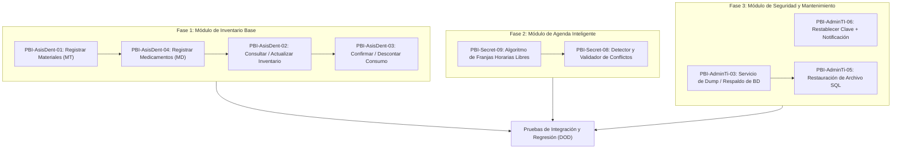
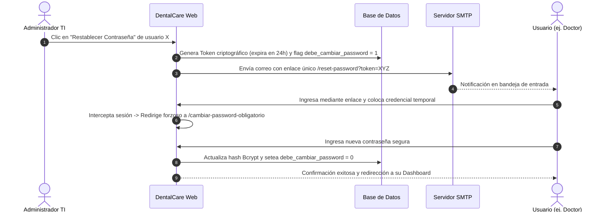

# Guía de Implementación y Arquitectura — Sprint 4 (DentalCare)

**Proyecto:** Sistema Informático para la Gestión de Servicios Médicos en la Clínica Odontológica DentalCare  
**Asignatura:** Diseño de Sistemas II (DSI215) — Ciclo II-2026  
**Objetivo del Documento:** Especificación técnica, funcional y procedural de las Historias de Usuario del **Sprint 4** para guiar el desarrollo de base de datos, backend (APIs) y frontend (UI/UX).

---

## 1. Visión General del Sprint 4

El **Sprint 4** expande las capacidades del sistema en tres áreas fundamentales:
1. **Gestión de Suministros Clínicos (Rol: Asistente Dental):** Catálogo de materiales, ingreso de medicamentos, consulta de existencias y control/confirmación de consumos mensuales por procedimientos.
2. **Agenda Inteligente y Control de Conflictos (Rol: Recepcionista):** Identificación visual de horarios libres y bloqueo en tiempo real de solapamientos o duplicidad de citas.
3. **Seguridad Avanzada y Contingencia de Datos (Rol: Administrador TI):** Restablecimiento asistido de contraseñas con forzado de cambio, ejecución de respaldos manuales y restauración segura de la base de datos.

### 1.1 Resumen de Historias de Usuario del Sprint 4

| Clave | Título del PBI | Rol Responsable | Puntos (SP) | Subsistema / Módulo |
| :--- | :--- | :--- | :---: | :--- |
| **DENTALCARE-26** | `PBI-AsisDent-01: Registrar Materiales` | Asistente Dental | 3.0 | Inventario / Consumo |
| **DENTALCARE-48** | `PBI-AsisDent-04: Registrar Ingreso` | Asistente Dental | 4.0 | Inventario / Medicamentos |
| **DENTALCARE-46** | `PBI-AsisDent-02: Consultar Inventario` | Asistente Dental | 2.0 | Inventario General |
| **DENTALCARE-47** | `PBI-AsisDent-03: Confirmar Consumo` | Asistente Dental | 2.0 | Consumo y Trazabilidad |
| **DENTALCARE-62** | `PBI-Secret-09: Identificar horarios disponibles` | Recepcionista | 2.0 | Agenda Médica |
| **DENTALCARE-60** | `PBI-Secret-08: Detectar conflictos de duplicación` | Recepcionista | 2.0 | Agenda Médica |
| **DENTALCARE-93** | `PBI-AdminTI-06: Restablecer Contraseña` | Administrador TI | 5.0 | Seguridad de Accesos |
| **DENTALCARE-53** | `PBI-AdminTi-03: Ejecutar Respaldos` | Administrador TI | 3.0 | Mantenimiento / BD |
| **DENTALCARE-64** | `PBI-AdminTi-05: Restaurar Información` | Administrador TI | 3.0 | Mantenimiento / BD |
| **DENTALCARE-97** | `Retroalimentación Laboratorio II` | Equipo General | — | Calidad Transversal (Finalizada) |

---

## 2. Hoja de Ruta de Programación (Orden Lógico Recomendado)

Para evitar bloqueos entre desarrolladores y garantizar coherencia en la base de datos, se recomienda seguir el siguiente orden secuencial:



---

## 3. Esquema de Base de Datos para el Sprint 4

Para soportar las nuevas funcionalidades, se requieren las siguientes tablas y ajustes relacionales:

### 3.1 Modelo Entidad-Relación (DDL Sugerido)

```sql
-- 1. Tabla de Materiales Clínicos
CREATE TABLE materiales (
    id INT AUTO_INCREMENT PRIMARY KEY,
    codigo VARCHAR(20) NOT NULL UNIQUE,          -- Ej: MT78 (Validación: MT + dígitos)
    nombre VARCHAR(100) NOT NULL,                -- Longitud entre 5 y 100 caracteres
    unidad_medida VARCHAR(50) NOT NULL,          -- Ej: 'Jeringa 4g', 'Caja x 100', 'Tubo'
    stock_actual INT NOT NULL DEFAULT 0,
    stock_minimo INT NOT NULL DEFAULT 5,
    descripcion TEXT NULL,
    creado_en TIMESTAMP DEFAULT CURRENT_TIMESTAMP,
    actualizado_en TIMESTAMP DEFAULT CURRENT_TIMESTAMP ON UPDATE CURRENT_TIMESTAMP,
    CONSTRAINT chk_material_nombre_len CHECK (CHAR_LENGTH(nombre) >= 5),
    CONSTRAINT chk_material_stock CHECK (stock_actual >= 0),
    CONSTRAINT chk_material_stock_min CHECK (stock_minimo >= 0)
);

-- 2. Tabla de Medicamentos
CREATE TABLE medicamentos (
    id INT AUTO_INCREMENT PRIMARY KEY,
    codigo VARCHAR(20) NOT NULL UNIQUE,          -- Ej: MD45 (Validación: MD + dígitos)
    nombre VARCHAR(100) NOT NULL,                -- Longitud entre 5 y 100 caracteres
    presentacion VARCHAR(100) NOT NULL,          -- Ej: 'Cápsulas 500mg', 'Frasco Gotero'
    lote VARCHAR(50) NULL,
    fecha_vencimiento DATE NULL,
    stock_actual INT NOT NULL DEFAULT 0,
    stock_minimo INT NOT NULL DEFAULT 5,
    creado_en TIMESTAMP DEFAULT CURRENT_TIMESTAMP,
    actualizado_en TIMESTAMP DEFAULT CURRENT_TIMESTAMP ON UPDATE CURRENT_TIMESTAMP,
    CONSTRAINT chk_medicamento_nombre_len CHECK (CHAR_LENGTH(nombre) >= 5),
    CONSTRAINT chk_medicamento_stock CHECK (stock_actual >= 0)
);

-- 3. Tabla de Consumos Mensuales por Procedimiento
CREATE TABLE consumos (
    id INT AUTO_INCREMENT PRIMARY KEY,
    tipo_item ENUM('MATERIAL', 'MEDICAMENTO') NOT NULL,
    item_id INT NOT NULL,                        -- ID referenciado a materiales o medicamentos
    item_codigo VARCHAR(20) NOT NULL,
    item_nombre VARCHAR(100) NOT NULL,
    cita_id INT NULL,                            -- Opcional: vinculado a la consulta médica
    cantidad INT NOT NULL,                       -- Cantidad utilizada
    mes_consumo VARCHAR(7) NOT NULL,             -- Formato 'YYYY-MM'
    estado ENUM('PENDIENTE', 'CONFIRMADO', 'ANULADO') DEFAULT 'PENDIENTE',
    fecha_consumo DATETIME NOT NULL DEFAULT CURRENT_TIMESTAMP,
    usuario_registro_id INT NOT NULL,            -- Asistente Dental que registra
    notas VARCHAR(255) NULL,
    FOREIGN KEY (usuario_registro_id) REFERENCES usuarios(id)
);

-- 4. Tabla de Tokens de Restablecimiento de Contraseñas
CREATE TABLE password_resets (
    id INT AUTO_INCREMENT PRIMARY KEY,
    usuario_id INT NOT NULL,
    token VARCHAR(128) NOT NULL UNIQUE,
    expira_en DATETIME NOT NULL,
    utilizado BOOLEAN DEFAULT FALSE,
    creado_en TIMESTAMP DEFAULT CURRENT_TIMESTAMP,
    FOREIGN KEY (usuario_id) REFERENCES usuarios(id) ON DELETE CASCADE
);

-- Modificación en tabla 'usuarios': flag para forzar cambio de clave
ALTER TABLE usuarios ADD COLUMN debe_cambiar_password BOOLEAN DEFAULT FALSE;

-- 5. Tabla de Registro de Respaldos de Base de Datos
CREATE TABLE respaldos (
    id INT AUTO_INCREMENT PRIMARY KEY,
    nombre_archivo VARCHAR(255) NOT NULL,        -- backup_dentalcare_YYYYMMDD_HHMMSS.sql.gz
    ruta_almacenamiento VARCHAR(500) NOT NULL,
    tamanio_bytes BIGINT NOT NULL,
    estado ENUM('EXITOSO', 'FALLIDO') DEFAULT 'EXITOSO',
    usuario_id INT NOT NULL,                     -- Administrador TI
    creado_en TIMESTAMP DEFAULT CURRENT_TIMESTAMP,
    FOREIGN KEY (usuario_id) REFERENCES usuarios(id)
);
```

---

## 4. Bloque 1: Módulo de Inventario y Suministros (Rol: Asistente Dental)

Este subsistema permite al **Asistente Dental** registrar insumos, abastecer medicamentos, consultar el inventario en tiempo real y validar consumos mensuales antes de descontarlos del stock físico.

---

### 4.1 PBI-AsisDent-01: Registrar Materiales
- **Clave Jira:** `DENTALCARE-26`
- **Rol:** Asistente Dental
- **Story Points:** 3.0
- **Parent / Épica:** Consumo de Materiales / Inventario

#### Propósito y Funcionamiento
Permite dar de alta nuevos materiales odontológicos (ej: resinas, amalgamas, guantes, algodón) dentro del catálogo institucional. El formulario debe validar en vivo que el código cumpla la nomenclatura clínica (prefijo `MT`) y que el nombre posea entre 5 y 100 caracteres.

#### Criterios de Aceptación (AC)
1. Los materiales son registrados con:
   - Código con formato alfanumérico (ej: `MT78`).
   - Nombre entre 5 y 100 caracteres.
2. Se debe mostrar la casilla con **borde rojo** cuando se ingresan datos no válidos.
3. El guardado exitoso debe mostrar una **notificación toast verde** de éxito.
4. Si ocurre un fallo (ej: código duplicado), debe mostrarse una **notificación de error**.
5. Al guardar exitosamente, debe ofrecer un botón/enlace de **redirección directa al listado de materiales**.

#### Especificación Técnica de APIs
- **Endpoint:** `POST /api/inventario/materiales/`
- **Permisos:** Requiere autenticación con rol `Asistente Dental` o `Administrador TI`.
- **Payload Request:**
```json
{
  "codigo": "MT78",
  "nombre": "Resina Fotocurable A2",
  "unidad_medida": "Jeringa 4g",
  "stock_inicial": 25,
  "stock_minimo": 5,
  "descripcion": "Resina compuesta universal para obturación estética"
}
```
- **Respuestas:**
  - `201 Created`: `{"status": "success", "message": "Material registrado con éxito", "data": {"id": 12, "codigo": "MT78"}}`
  - `400 Bad Request`: `{"status": "error", "message": "El código MT78 ya existe o los datos no son válidos", "errors": {"nombre": ["Debe contener entre 5 y 100 caracteres"]}}`

#### Lógica de Frontend (UI/UX)
- Formulario reactivo con validación `onChange` y `onBlur`.
- Aplicar clase CSS `input-error` (`border: 2px solid #ef4444; background-color: #fef2f2;`) si `nombre.length < 5` o `!/^MT\d+$/i.test(codigo)`.
- Componente Modal / Toast de confirmación con dos botones: `"Ir al Listado de Materiales"` (redirige a `/inventario/materiales`) y `"Registrar Otro Material"` (limpia el formulario).

---

### 4.2 PBI-AsisDent-04: Registrar Ingreso de Medicamentos
- **Clave Jira:** `DENTALCARE-48`
- **Rol:** Asistente Dental
- **Story Points:** 4.0
- **Parent / Épica:** Inventario / Farmacia

#### Propósito y Funcionamiento
Permite ingresar nuevos medicamentos o reabastecer lotes de fármacos clínicos (anestésicos, analgésicos, antibióticos) que serán utilizados en las recetas o cirugías de los odontólogos.

#### Criterios de Aceptación (AC)
1. Los medicamentos son registrados con:
   - Código único (ej: `MD45`).
   - Nombre entre 5 y 100 caracteres.
2. Campo de cantidad a ingresar debe ser mayor que 0 (`cantidad >= 1`).
3. Resaltar la casilla en **color rojo** ante entradas no válidas.
4. Notificación visual amigable ante registro exitoso o en caso de error.
5. Ofrecer redirección inmediata a la pantalla de listado de medicamentos.

#### Especificación Técnica de APIs
- **Endpoint:** `POST /api/inventario/medicamentos/`
- **Payload Request:**
```json
{
  "codigo": "MD45",
  "nombre": "Amoxicilina 500mg cápsulas",
  "presentacion": "Caja x 30 cápsulas",
  "lote": "LOT-2026-X9",
  "fecha_vencimiento": "2027-08-31",
  "cantidad_ingreso": 50,
  "stock_minimo": 10
}
```
- **Respuestas:**
  - `201 Created`: `{"status": "success", "message": "Medicamento ingresado correctamente", "nuevo_stock": 50}`
  - `400 Bad Request`: `{"status": "error", "message": "Cantidad inválida o nombre demasiado corto"}`

---

### 4.3 PBI-AsisDent-02: Consultar y Actualizar Inventario
- **Clave Jira:** `DENTALCARE-46`
- **Rol:** Asistente Dental
- **Story Points:** 2.0
- **Parent / Épica:** Inventario

#### Propósito y Funcionamiento
Interfaz centralizada de consulta donde el personal asistente puede ver el inventario completo, buscar insumos rápidamente por código o nombre, filtrar por stock crítico y actualizar valores de stock o detalles de un ítem si se detecta un desfase físico.

#### Criterios de Aceptación (AC)
1. Muestra una tabla con todos los materiales y medicamentos registrados.
2. Permite editar/actualizar los registros del listado (in-line o mediante modal de edición).
3. La actualización exitosa emite una notificación toast de confirmación.
4. Si ocurre un fallo en el guardado, emite una notificación de error descriptiva.
5. Al confirmar la actualización, la tabla refleja los nuevos valores inmediatamente sin recarga total de la página (React State / AJAX).

#### Especificación Técnica de APIs
- **Listar:** `GET /api/inventario/items/?search=resina&tipo=todos&page=1`
  - Retorna lista paginada con campos: `id`, `codigo`, `nombre`, `tipo`, `stock_actual`, `stock_minimo`, `estado_alerta`.
- **Actualizar:** `PATCH /api/inventario/items/{id}/`
  - Payload: `{"stock_actual": 30, "stock_minimo": 8, "motivo_ajuste": "Conteo físico quincenal"}`
  - Retorna: `200 OK` con el ítem actualizado.

---

### 4.4 PBI-AsisDent-03: Confirmar Consumo Mensual de Materiales
- **Clave Jira:** `DENTALCARE-47`
- **Rol:** Asistente Dental
- **Story Points:** 2.0
- **Parent / Épica:** Consumo de Materiales

#### Propósito y Funcionamiento
Provee una interfaz visual basada en **tarjetas o recuadros mensuales** donde se agrupan los consumos registrados por las atenciones del consultorio. El asistente puede revisar los consumos, corregir cantidades erróneas si hubo equivocación y finalmente presionar `"Confirmar Consumo"`, lo que descuenta de forma atómica el stock físico del almacén.

```
+---------------------------------------------------------------------------------+
| CONSUMOS REGISTRADOS - OCTUBRE 2026                                              |
+---------------------------------------------------------------------------------+
| [ RECUADRO #1 ]                     | [ RECUADRO #2 ]                           |
| Ítem: MT78 - Resina Fotocurable A2  | Ítem: MD12 - Lidocaína 2% con Epinefrina  |
| Cantidad registrada: 2 jeringas     | Cantidad registrada: 4 cartuchos          |
| Cita: #CITA-204 (Dra. Ramos)        | Cita: #CITA-205 (Dr. Martínez)            |
| Estado: PENDIENTE                   | Estado: PENDIENTE                         |
|                                     |                                           |
| [ Modificar Datos ] [ Confirmar ]   | [ Modificar Datos ] [ Confirmar ]         |
+---------------------------------------------------------------------------------+
```

#### Criterios de Aceptación (AC)
1. Se deben mostrar recuadros/tarjetas con los datos de cada consumo hecho en el transcurso del mes.
2. Permite modificar las cantidades o ítem del consumo antes de confirmarlo.
3. La modificación exitosa muestra notificación y se refleja de inmediato en su tarjeta.
4. Si ocurre un error (ej: sobreconsumo que supere las existencias físicas), muestra notificación de error.
5. Al pulsar "Confirmar Consumo", el estado de la tarjeta cambia a "CONFIRMADO" y el inventario descuenta las unidades correspondientes.

#### Especificación Técnica de APIs
- **Listar Consumos del Mes:** `GET /api/inventario/consumos/?mes=2026-10`
- **Modificar Consumo:** `PUT /api/inventario/consumos/{id}/`
  - Payload: `{"cantidad": 3, "notas": "Se requirió una jeringa adicional por fractura amplia"}`
- **Confirmar Consumo:** `POST /api/inventario/consumos/{id}/confirmar/`
  - Lógica interna:
    ```python
    # Transacción atómica
    with transaction.atomic():
        consumo = Consumo.objects.select_for_update().get(id=consumo_id)
        material = Material.objects.select_for_update().get(id=consumo.item_id)
        if material.stock_actual < consumo.cantidad:
            raise ValidationError("Stock insuficiente para confirmar el consumo.")
        material.stock_actual -= consumo.cantidad
        material.save()
        consumo.estado = 'CONFIRMADO'
        consumo.save()
    ```

---

## 5. Bloque 2: Módulo de Agenda Inteligente y Horarios (Rol: Recepcionista)

Este subsistema optimiza el proceso de agendamiento en recepción, automatizando el cálculo de horarios libres y blindando al sistema contra errores humanos de duplicidad de citas o cruces de agenda médica.

---

### 5.1 PBI-Secret-09: Identificar Horarios Disponibles
- **Clave Jira:** `DENTALCARE-62`
- **Rol:** Recepcionista
- **Story Points:** 2.0
- **Parent / Épica:** Agenda

#### Propósito y Funcionamiento
Al seleccionar un odontólogo y una fecha en el módulo de citas, el sistema calcula de forma dinámica los bloques de tiempo libres en la jornada laboral (ej: de 8:00 AM a 12:00 PM y de 2:00 PM a 6:00 PM con slots de 30 o 45 minutos), mostrando únicamente las franjas horarias disponibles para selección directa con un clic.

#### Criterios de Aceptación (AC)
1. El sistema muestra **únicamente los horarios libres** correspondientes al odontólogo y fecha elegidos.
2. Actualiza la disponibilidad en **tiempo real** al cambiar la fecha o el doctor.
3. Permite **seleccionar directamente un horario disponible** inyectándolo automáticamente en el formulario de la cita.

#### Algoritmo de Cálculo de Horarios Libres
```
1. Obtener Horario de Trabajo del Odontólogo para el día seleccionado (ej: 08:00 a 17:00, lunch 12:00-13:00).
2. Generar intervalos de slots regulares (ej. intervalos de 45 mins: 08:00, 08:45, 09:30, 10:15, 11:00...).
3. Consultar Citas Existentes para ese odontólogo en esa fecha con estados != 'CANCELADA'.
4. Franjas Disponibles = Intervalos Generados - Intervalos que colisionan con Citas Existentes.
5. Retornar únicamente los slots resultantes en estado libre.
```

#### Especificación Técnica de APIs
- **Endpoint:** `GET /api/agenda/disponibilidad/?odontologo_id=4&fecha=2026-10-24`
- **Respuesta JSON:**
```json
{
  "odontologo": "Dr. Roberto Carlos Martínez",
  "fecha": "2026-10-24",
  "horarios_disponibles": [
    {"hora_inicio": "08:00", "hora_fin": "08:45", "disponible": true},
    {"hora_inicio": "08:45", "hora_fin": "09:30", "disponible": true},
    {"hora_inicio": "10:15", "hora_fin": "11:00", "disponible": true},
    {"hora_inicio": "11:00", "hora_fin": "11:45", "disponible": true},
    {"hora_inicio": "14:00", "hora_fin": "14:45", "disponible": true}
  ]
}
```

---

### 5.2 PBI-Secret-08: Detectar Conflictos de Duplicación de Citas
- **Clave Jira:** `DENTALCARE-60`
- **Rol:** Recepcionista
- **Story Points:** 2.0
- **Parent / Épica:** Agenda

#### Propósito y Funcionamiento
Mecanismo de doble validación (frontend y backend) que previene que dos pacientes sean citados al mismo odontólogo o al mismo cubículo en el mismo horario, o que un mismo paciente tenga dos citas en horas idénticas.

#### Criterios de Aceptación (AC)
1. El sistema identifica cuando ya existe una cita en la misma fecha y hora para el odontólogo.
2. Bloquea la asignación de horarios ocupados impidiendo el guardado.
3. Muestra un mensaje/alerta visible indicando el conflicto detectado y sugiriendo alternativas.

#### Lógica de Validación y Bloqueo
- **En Frontend:** Los horarios ocupados se renderizan con estilo deshabilitado (`disabled`, color gris tenue, tooltip "Horario Ocupado").
- **En Backend (Validación Defensiva):**
```python
def validar_conflicto_cita(odontologo_id, fecha, hora_inicio, hora_fin, cita_id=None):
    query = Cita.objects.filter(
        odontologo_id=odontologo_id,
        fecha=fecha,
        estado__in=['PROGRAMADA', 'EN_ESPERA', 'EN_CONSULTA']
    ).filter(
        Q(hora_inicio__lt=hora_fin) & Q(hora_fin__gt=hora_inicio)
    )
    if cita_id:
        query = query.exclude(id=cita_id) # Para reprogramaciones
    if query.exists():
        raise ValidationError("Conflicto detectado: El odontólogo ya tiene una cita asignada en ese bloque horario.")
```
- **Respuesta ante Conflicto:** `409 Conflict`
```json
{
  "status": "conflict",
  "message": "Conflicto de horario: El Dr. Roberto Carlos Martínez ya cuenta con una cita de 09:30 AM a 10:15 AM en la fecha indicada."
}
```

---

## 6. Bloque 3: Módulo de Seguridad y Mantenimiento de BD (Rol: Administrador TI)

Este subsistema brinda herramientas avanzadas al **Administrador TI** para soporte a usuarios y contingencia técnica ante fallos en el servidor.

---

### 6.1 PBI-AdminTI-06: Restablecer Contraseña de Usuario
- **Clave Jira:** `DENTALCARE-93`
- **Rol:** Administrador TI
- **Story Points:** 5.0
- **Parent / Épica:** Seguridad

#### Propósito y Funcionamiento
Permite al Administrador TI asistir a cualquier miembro del personal (odontólogo, secretaria, asistente, gerente) que haya extraviado su contraseña. El sistema genera un enlace tokenizado temporal o clave provisional, lo envía al correo del usuario y marca la cuenta con la bandera `debe_cambiar_password = True` para forzar la actualización obligatoria de credenciales en el primer inicio de sesión.

#### Criterios de Aceptación (AC)
1. El sistema genera una contraseña temporal o link de restablecimiento con token criptográfico.
2. Se envía notificación automática al correo institucional del usuario.
3. Se obliga al usuario a cambiar la contraseña en su primer inicio de sesión antes de acceder a las vistas del sistema.

#### Flujo Procedural de la Funcionalidad


#### Middleware de Forzado de Cambio de Clave
```python
# Ejemplo en Backend (Django / Express Middleware)
class ForzarCambioPasswordMiddleware:
    def process_request(self, request):
        if request.user.is_authenticated and request.user.debe_cambiar_password:
            ruta_permitida = ['/cambiar-password-obligatorio/', '/logout/', '/api/cambiar-password/']
            if request.path not in ruta_permitida:
                return redirect('/cambiar-password-obligatorio/')
```

---

### 6.2 PBI-AdminTi-03: Ejecutar Respaldos de Base de Datos
- **Clave Jira:** `DENTALCARE-53`
- **Rol:** Administrador TI
- **Story Points:** 3.0
- **Parent / Épica:** Seguridad / Mantenimiento

#### Propósito y Funcionamiento
Facilita la ejecución de volcados completos de la base de datos relacional (esquema + tablas + secuencias) sin interrumpir el funcionamiento de la clínica. Genera un archivo `.sql` o comprimido `.sql.gz` con fecha y hora en el nombre, guardándolo en un directorio seguro y registrándolo en la tabla de respaldos con opción de descarga directa.

#### Criterios de Aceptación (AC)
1. Permite ejecutar un respaldo manual de la base de datos a petición.
2. Genera un archivo con nomenclatura estandarizada: `backup_dentalcare_YYYYMMDD_HHMMSS.sql.gz`.
3. Muestra confirmación en pantalla cuando el respaldo se completa exitosamente y lo añade a la tabla histórica.

#### Especificación Técnica de Backend
- **Endpoint:** `POST /api/mantenimiento/respaldos/generar/`
- **Comando Ejecutado en Servidor (Subproceso seguro):**
  - Para MySQL: `mysqldump -u dental_user -p dentalcare | gzip > /backups/backup_dentalcare_20261024_153000.sql.gz`
  - Para PostgreSQL: `pg_dump -Fc dentalcare > /backups/backup_dentalcare_20261024_153000.dump`
- **Respuesta JSON:**
```json
{
  "status": "success",
  "message": "Respaldo completado exitosamente",
  "archivo": "backup_dentalcare_20261024_153000.sql.gz",
  "tamanio_mb": 14.8,
  "fecha": "2026-10-24 15:30:00"
}
```

---

### 6.3 PBI-AdminTi-05: Restaurar Información desde Respaldo
- **Clave Jira:** `DENTALCARE-64`
- **Rol:** Administrador TI
- **Story Points:** 3.0
- **Parent / Épica:** Seguridad Avanzada / Mantenimiento

#### Propósito y Funcionamiento
Mecanismo de recuperación de desastres que permite seleccionar un archivo de respaldo previamente generado o subir uno válido para restablecer la base de datos al estado capturado en dicho snapshot.

#### Criterios de Aceptación (AC)
1. Permite seleccionar un archivo de respaldo desde la lista de respaldos existentes o mediante carga de archivo.
2. Solicita **doble confirmación con ventana modal de advertencia crítica** antes de ejecutar la restauración (advirtiendo que se sobrescribirán los datos actuales).
3. Notifica en pantalla cuando la restauración finaliza exitosamente.

#### Flujo de Seguridad en Frontend (Doble Confirmación)
1. El Administrador TI pulsa `"Restaurar"` sobre un respaldo.
2. Modal emergente:  
   *⚠️ ADVERTENCIA CRÍTICA: La restauración reemplazará todos los datos actuales del sistema por los contenidos en el respaldo seleccionado. Esta acción no se puede deshacer.*  
   *Para confirmar, escriba la palabra `RESTAURAR` y su contraseña de Administrador.*
3. Se envía la petición al backend; el sistema bloquea nuevas escrituras durante la carga del volcado.
4. Al concluir, el backend invalida las sesiones activas y responde con código `200 OK`.

---

## 7. Directrices de Calidad Transversal (Retroalimentación Laboratorio 3)

La historia **DENTALCARE-97** establece requerimientos de calidad que deben aplicarse a todas las nuevas vistas del Sprint 4:
1. **Componente `SearchableSelect`:** En los selectores de materiales, medicamentos y citas, implementar búsqueda y filtrado asíncrono o reactivo en tiempo real (evitar etiquetas `<select>` nativas estáticas con más de 20 opciones).
2. **Validación Visual de Errores:** Bordes en color rojo (`#ef4444`), fondos tenues (`#fef2f2`) y textos de ayuda en línea para todo campo inválido.
3. **Control de Procedimientos Generales:** Asegurarse de que en las citas y consumos los procedimientos que no aplican a un diente específico admitan `pieza_dental = null`.
4. **Validación de Menores de Edad:** Si en las citas se atiende a un paciente menor de 18 años, el sistema debe exigir obligatoriamente los datos y contacto del tutor legal.

---

## 8. Checklist de Validación y Entrega (Definition of Done - DOD)

Antes de marcar cualquier historia del Sprint 4 como **"Finalizada"**, cada desarrollador debe verificar:

- [ ] **Migraciones de BD:** Esquema creado y probado sin romper datos de Sprints 1, 2 y 3.
- [ ] **Validación de AC:** Todos los Criterios de Aceptación de la tarjeta en Jira han sido probados con casos exitosos y fallidos.
- [ ] **Control de Acceso (RBAC):** El endpoint o vista sólo es accesible por el rol asignado (Asistente Dental, Recepcionista o Admin TI); otros roles reciben `403 Forbidden`.
- [ ] **Feedback Visual UI:** Notificaciones toast (verdes para éxito, rojas para errores) y bordes rojos en campos requeridos o con formato inválido.
- [ ] **Manejo de Transacciones:** Operaciones de inventario y consumo usan transacciones atómicas (`atomic transaction`) para evitar inconsistencias de stock.
- [ ] **Versionamiento en Git:** Código subido a la rama correspondiente (`feature/sprint-4-*`) con mensajes de commit descriptivos y pull request revisado.
- [ ] **Despliegue Remoto:** Funcionalidad operativa en el servidor cloud (no en local).
