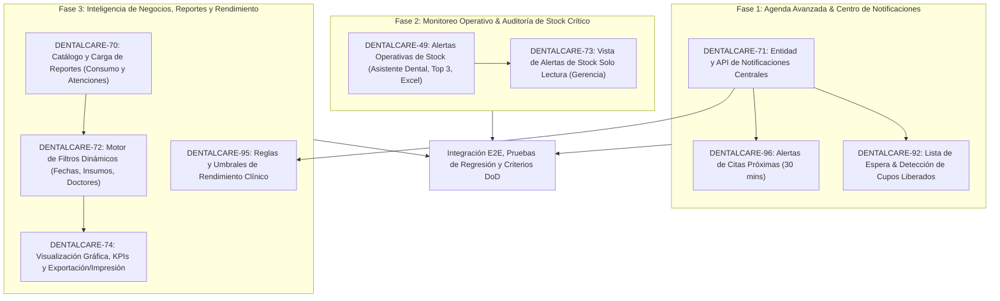

# Guía de Implementación y Arquitectura — Sprint 5 (DentalCare ERP)

**Proyecto:** Sistema Informático para la Gestión de Servicios Médicos en la Clínica Odontológica DentalCare  
**Asignatura:** Diseño de Sistemas II (DSI215) — Ciclo II-2026  
**Institución:** Universidad de El Salvador (UES)  
**Objetivo del Documento:** Especificación técnica, funcional, arquitectónica y procedural de las Historias de Usuario (PBIs) correspondientes al **Sprint 5**, consolidando la base relacional, backend (Spring Boot) y frontend (React + Vite) construida en los Sprints 1, 2, 3 y 4.

---

## 1. Visión General del Sprint 5

El **Sprint 5** consolida la madurez operativa y analítica del sistema DentalCare en tres pilares estratégicos:
1. **Agenda Avanzada, Lista de Espera y Centro de Notificaciones (Rol: Recepcionista / Secretaria):**
   - Configuración y emisión de alertas de citas próximas (30 minutos antes).
   - Gestión inteligente de listas de espera de pacientes con asignación automática o priorizada ante cancelaciones de citas.
   - Centro unificado de notificaciones del sistema con marcado de lectura individual y masiva.
2. **Supervisión Operativa y Auditoría de Stock Crítico (Roles: Asistente Dental y Gerente):**
   - Módulo operativo para el Asistente Dental: detección de insumos próximos a agotarse, widget Top 3 más críticos, enlaces de abastecimiento inmediato y exportación de reportes de existencias críticas a Excel.
   - Módulo gerencial de supervisión: visualización de alertas de insumos en modo **solo lectura** (sin permisos de edición de stock físico), con ordenamiento por criticidad y severidad para toma de decisiones de compras.
3. **Inteligencia de Negocios, Reportes Ejecutivos y Alertas de Rendimiento (Rol: Gerente):**
   - Generación de reportes ejecutivos: consumo de materiales y estadísticas de atenciones odontológicas.
   - Motor de filtrado multidimensional: períodos, fechas, insumos y profesionales de la salud.
   - Visualización analítica con indicadores clave de rendimiento (KPIs), tablas dinámicas y gráficos estadísticos con soporte de exportación a Excel e impresión formateada.
   - Configuración personalizada de alertas de rendimiento basadas en valores umbral (cancelaciones máximas, atenciones mínimas).

---

### 1.1 Resumen Consolidado de PBIs del Sprint 5 (Jira Backlog)

El Sprint 5 comprende un total de **9 Historias de Usuario / PBIs**, acumulando **21.0 Story Points (SP)** distribuidos entre tres roles clave:

| Clave Jira | Código PBI | Título de la Historia de Usuario | Rol Responsable | Puntos (SP) | Épica / Subsistema | Prioridad |
| :---: | :---: | :--- | :--- | :---: | :--- | :---: |
| **DENTALCARE-96** | `PBI-Secret-15` | Configurar Alertas de Citas Próximas | Recepcionista / Secretaria | 2.0 | `DENTALCARE-29` (Agenda) | Media |
| **DENTALCARE-92** | `PBI-Secret-14` | Gestionar Lista de Espera | Recepcionista / Secretaria | 3.0 | `DENTALCARE-29` (Agenda) | Media |
| **DENTALCARE-71** | `PBI-Secret-16` | Revisar notificaciones | Recepcionista / Secretaria | 2.0 | `DENTALCARE-32` (Notificaciones) | Media |
| **DENTALCARE-49** | `PBI-AsisDent-05` | Revisar Alertas de Stock | Asistente Dental | 3.0 | `DENTALCARE-42` (Consumo de Materiales) | Media |
| **DENTALCARE-73** | `PBI-Gerencia-03` | Visualizar Alertas De Stock | Gerente | 2.0 | `DENTALCARE-45` (Stock Críticos) | Media |
| **DENTALCARE-70** | `PBI-Gerencia-01` | Seleccionar Reporte | Gerente | 2.0 | `DENTALCARE-44` (Reportes) | Media |
| **DENTALCARE-72** | `PBI-Gerencia-02` | Aplicar Filtros a Reportes | Gerente | 2.0 | `DENTALCARE-44` (Reportes) | Media |
| **DENTALCARE-74** | `PBI-Gerencia-04` | Visualizar Resultados de Reportes | Gerente | 3.0 | `DENTALCARE-45` (Stock Críticos) | Media |
| **DENTALCARE-95** | `PBI-Gerencia-05` | Configurar Alertas de Rendimiento | Gerente | 2.0 | `DENTALCARE-32` (Notificaciones) | Media |
| **TOTAL** | **9 PBIs** | **Sprint 5 DentalCare** | **Recepcionista, Asistente, Gerente** | **21.0 SP** | **Agenda, Stock, Reportes** | — |

---

## 2. Hoja de Ruta de Programación (Fases y Orden Lógico de Construcción)

Para garantizar la estabilidad del software, evitar bloqueos entre desarrolladores y respetar las dependencias relacionales, el Sprint 5 se estructura en **3 fases secuenciales**:



---

## 3. Esquema de Base de Datos para el Sprint 5

Para soportar las nuevas entidades y flujos requeridos por el Sprint 5 en el motor **MySQL 8.0** de Aiven, se incorporan 4 nuevas tablas y sus respectivas claves foráneas:

```sql
-- =============================================================================
-- SCRIPT DDL: SPRINT 5 — DENTALCARE ERP (AIVEN MYSQL)
-- =============================================================================

USE `bd_dentalcareweb`;

-- -----------------------------------------------------------------------------
-- 1. TABLA: notificaciones (Centro Central de Notificaciones)
-- -----------------------------------------------------------------------------
CREATE TABLE IF NOT EXISTS `notificaciones` (
  `id` INT NOT NULL AUTO_INCREMENT,
  `usuario_id` INT DEFAULT NULL COMMENT 'Usuario específico destinatario (NULL si aplica a todo un rol)',
  `rol_destinatario` VARCHAR(50) DEFAULT NULL COMMENT 'Rol al que se dirige: RECEPCIONISTA, GERENTE, ASISTENTEODONTOLOGO',
  `titulo` VARCHAR(150) NOT NULL,
  `mensaje` TEXT NOT NULL,
  `tipo` ENUM('CITA_PROXIMA', 'LISTA_ESPERA', 'STOCK_CRITICO', 'RENDIMIENTO', 'SISTEMA') NOT NULL,
  `leida` BOOLEAN NOT NULL DEFAULT FALSE,
  `fecha_creacion` DATETIME NOT NULL DEFAULT CURRENT_TIMESTAMP,
  `referencia_id` INT DEFAULT NULL COMMENT 'ID de la entidad vinculada (id_citas, id material, etc.)',
  `ruta_redireccion` VARCHAR(255) DEFAULT NULL COMMENT 'Ruta interna en frontend para navegación contextual',
  PRIMARY KEY (`id`),
  KEY `idx_notificaciones_usuario` (`usuario_id`),
  KEY `idx_notificaciones_rol` (`rol_destinatario`),
  KEY `idx_notificaciones_leida` (`leida`),
  CONSTRAINT `fk_notificaciones_usuario` FOREIGN KEY (`usuario_id`) REFERENCES `usuario` (`id_usuario`) ON DELETE CASCADE
) ENGINE=InnoDB DEFAULT CHARSET=utf8mb4 COLLATE=utf8mb4_0900_ai_ci;

-- -----------------------------------------------------------------------------
-- 2. TABLA: lista_espera (Gestión de Pacientes en Espera de Cupos de Agenda)
-- -----------------------------------------------------------------------------
CREATE TABLE IF NOT EXISTS `lista_espera` (
  `id` INT NOT NULL AUTO_INCREMENT,
  `paciente_id` INT NOT NULL,
  `odontologo_id` INT DEFAULT NULL COMMENT 'Odontólogo preferido (NULL si es indistinto)',
  `rango_horario_preferido` VARCHAR(100) NOT NULL COMMENT 'Ej: Mañana (08:00 - 12:00), Tarde (14:00 - 18:00)',
  `dias_preferidos` VARCHAR(100) DEFAULT NULL COMMENT 'Ej: Lunes a Jueves',
  `motivo_consulta` VARCHAR(255) NOT NULL,
  `prioridad` ENUM('ALTA', 'MEDIA', 'BAJA') NOT NULL DEFAULT 'MEDIA',
  `estado` ENUM('EN_ESPERA', 'NOTIFICADO', 'AGENDADO', 'DESCARTADO') NOT NULL DEFAULT 'EN_ESPERA',
  `fecha_solicitud` DATETIME NOT NULL DEFAULT CURRENT_TIMESTAMP,
  `cita_asignada_id` INT DEFAULT NULL COMMENT 'Cita formal generada a partir de la lista',
  `notas` TEXT DEFAULT NULL,
  PRIMARY KEY (`id`),
  KEY `idx_lista_espera_paciente` (`paciente_id`),
  KEY `idx_lista_espera_odontologo` (`odontologo_id`),
  KEY `idx_lista_espera_estado` (`estado`),
  CONSTRAINT `fk_lista_espera_paciente` FOREIGN KEY (`paciente_id`) REFERENCES `paciente` (`id_paciente`) ON DELETE CASCADE,
  CONSTRAINT `fk_lista_espera_odontologo` FOREIGN KEY (`odontologo_id`) REFERENCES `odontologo` (`id_odontologo`) ON DELETE SET NULL,
  CONSTRAINT `fk_lista_espera_cita` FOREIGN KEY (`cita_asignada_id`) REFERENCES `cita` (`id_citas`) ON DELETE SET NULL
) ENGINE=InnoDB DEFAULT CHARSET=utf8mb4 COLLATE=utf8mb4_0900_ai_ci;

-- -----------------------------------------------------------------------------
-- 3. TABLA: configuracion_alerta_cita (Preferencia de Alertas por Usuario/Secretaria)
-- -----------------------------------------------------------------------------
CREATE TABLE IF NOT EXISTS `configuracion_alerta_cita` (
  `id` INT NOT NULL AUTO_INCREMENT,
  `usuario_id` INT NOT NULL UNIQUE,
  `alertas_activas` BOOLEAN NOT NULL DEFAULT TRUE,
  `tiempo_anticipacion_minutos` INT NOT NULL DEFAULT 30,
  `sonido_activo` BOOLEAN NOT NULL DEFAULT TRUE,
  `actualizado_en` DATETIME NOT NULL DEFAULT CURRENT_TIMESTAMP ON UPDATE CURRENT_TIMESTAMP,
  PRIMARY KEY (`id`),
  CONSTRAINT `fk_config_alerta_usuario` FOREIGN KEY (`usuario_id`) REFERENCES `usuario` (`id_usuario`) ON DELETE CASCADE
) ENGINE=InnoDB DEFAULT CHARSET=utf8mb4 COLLATE=utf8mb4_0900_ai_ci;

-- -----------------------------------------------------------------------------
-- 4. TABLA: reglas_alerta_rendimiento (Umbrales de Indicadores Clave para Gerencia)
-- -----------------------------------------------------------------------------
CREATE TABLE IF NOT EXISTS `reglas_alerta_rendimiento` (
  `id` INT NOT NULL AUTO_INCREMENT,
  `nombre_indicador` VARCHAR(100) NOT NULL,
  `descripcion` VARCHAR(255) DEFAULT NULL,
  `tipo_metrica` ENUM('ATENCIONES_MINIMAS', 'MAX_CANCELACIONES_PORCENTAJE', 'STOCK_CRITICO_CANTIDAD', 'TIEMPO_ESPERA_PROMEDIO_MINS') NOT NULL,
  `operador_comparacion` ENUM('MENOR_QUE', 'MENOR_IGUAL_QUE', 'MAYOR_QUE', 'MAYOR_IGUAL_QUE') NOT NULL,
  `valor_umbral` DECIMAL(10,2) NOT NULL,
  `periodo_evaluacion` ENUM('DIARIO', 'SEMANAL', 'MENSUAL') NOT NULL DEFAULT 'SEMANAL',
  `activo` BOOLEAN NOT NULL DEFAULT TRUE,
  `ultima_evaluacion` DATETIME DEFAULT NULL,
  `ultimo_valor_detectado` DECIMAL(10,2) DEFAULT NULL,
  `usuario_creador_id` INT NOT NULL,
  `creado_en` DATETIME NOT NULL DEFAULT CURRENT_TIMESTAMP,
  PRIMARY KEY (`id`),
  KEY `idx_reglas_alerta_usuario` (`usuario_creador_id`),
  CONSTRAINT `fk_reglas_alerta_usuario` FOREIGN KEY (`usuario_creador_id`) REFERENCES `usuario` (`id_usuario`)
) ENGINE=InnoDB DEFAULT CHARSET=utf8mb4 COLLATE=utf8mb4_0900_ai_ci;
```

---

## 4. Fase 1: Módulo de Agenda Avanzada, Lista de Espera y Notificaciones

Esta fase atiende los requerimientos operativos de la **Recepcionista / Secretaria** y dota al sistema de un mecanismo transversal de notificaciones.

---

### 4.1 PBI-Secret-16: Revisar Notificaciones
- **Clave Jira:** `DENTALCARE-71`
- **Rol:** Recepcionista / Secretaria (Transversal al personal clínico)
- **Story Points:** 2.0
- **Épica:** `DENTALCARE-32` (Notificaciones)

#### Propósito y Funcionamiento
Permite a la recepcionista y personal autorizado consultar la bandeja unificada de eventos clínicos y del sistema (citas próximas por iniciar, cupos liberados para la lista de espera, insumos en stock crítico y avisos de rendimiento). El usuario puede marcar elementos leídos individualmente o vaciar la lista mediante "marcar todas como leídas".

#### Criterios de Aceptación (AC Jira)
- [x] El sistema muestra una lista de notificaciones recientes ordenadas cronológicamente (más recientes primero).
- [x] El sistema permite marcar notificaciones como leídas de forma individual.
- [x] El sistema actualiza el estado de las notificaciones inmediatamente y descuenta el contador de no leídas.
- [x] El diagrama de casos de uso correspondiente fue creado y revisado por el equipo.
- [x] El módulo fue desarrollado siguiendo las convenciones de nomenclatura del proyecto.

#### Especificación Técnica de APIs
- **Listar Notificaciones del Usuario/Rol:**
  - `GET /api/notificaciones/?soloNoLeidas=false&limit=20`
  - Encabezado: `Authorization: Bearer <JWT>`
  - Respuesta `200 OK`:
    ```json
    {
      "totalNoLeidas": 3,
      "notificaciones": [
        {
          "id": 101,
          "titulo": "Cita Próxima en 30 Minutos",
          "mensaje": "Paciente Carlos Mendoza tiene cita a las 09:30 AM con Dra. Ramos.",
          "tipo": "CITA_PROXIMA",
          "leida": false,
          "fechaCreacion": "2026-11-05T09:00:00",
          "rutaRedireccion": "/agenda?citaId=45"
        }
      ]
    }
    ```
- **Conteo Rápido de No Leídas (Badge Navbar):**
  - `GET /api/notificaciones/resumen-no-leidas`
  - Respuesta `200 OK`: `{"contador": 3}`
- **Marcar una Notificación como Leída:**
  - `PATCH /api/notificaciones/{id}/marcar-leida`
  - Respuesta `200 OK`: `{"status": "success", "mensaje": "Notificación marcada como leída"}`
- **Marcar Todas como Leídas:**
  - `POST /api/notificaciones/marcar-todas-leidas`
  - Respuesta `200 OK`: `{"status": "success", "marcadas": 3}`

#### Lógica de Frontend (UI/UX)
- Componente `NotificationBell` ubicado en el Header/Navbar principal con contador dinámico (badge rojo si `contador > 0`).
- Dropdown emergente accesible al hacer clic en la campana, con pestañas: "Todas" y "No Leídas".
- Cada notificación incluye ícono temático (reloj para citas, advertencia para stock, usuario para lista de espera), texto descriptivo, tiempo transcurrido (ej: "hace 5 min") y botón de "Marcar como leída".
- Botón superior "Marcar todas como leídas" con confirmación sutil.

---

### 4.2 PBI-Secret-15: Configurar Alertas de Citas Próximas
- **Clave Jira:** `DENTALCARE-96`
- **Rol:** Recepcionista / Secretaria
- **Story Points:** 2.0
- **Épica:** `DENTALCARE-29` (Agenda)

#### Propósito y Funcionamiento
Brinda a la secretaria la capacidad de activar/desactivar recordatorios automáticos de citas del día y configurar la ventana de anticipación (predeterminada a 30 minutos antes). El sistema examina las citas programadas para el día y dispara una notificación en la interfaz cuando una cita entra en la ventana de aviso para que el personal recepcione oportunamente al paciente.

#### Criterios de Aceptación (AC Jira)
- [x] Permite emitir un recordatorio de las citas próximas a realizarse.
- [x] El sistema envía una alerta 30 minutos antes de la cita próxima.
- [x] Se puede activar o desactivar la alerta en cualquier momento desde la interfaz.
- [x] El diagrama de casos de uso correspondiente fue creado y revisado por el equipo.
- [x] El módulo fue desarrollado siguiendo las convenciones de nomenclatura del proyecto.

#### Especificación Técnica de APIs
- **Consultar Configuración de Alertas del Usuario:**
  - `GET /api/agenda/alertas-citas/configuracion`
  - Respuesta `200 OK`:
    ```json
    {
      "alertasActivas": true,
      "tiempoAnticipacionMinutos": 30,
      "sonidoActivo": true
    }
    ```
- **Actualizar Configuración de Alertas:**
  - `PUT /api/agenda/alertas-citas/configuracion`
  - Request Payload:
    ```json
    {
      "alertasActivas": true,
      "tiempoAnticipacionMinutos": 30,
      "sonidoActivo": false
    }
    ```
  - Respuesta `200 OK`: `{"status": "success", "mensaje": "Configuración de alertas actualizada correctamente"}`
- **Consultar Citas Próximas Inminentes:**
  - `GET /api/agenda/alertas-citas/proximas`
  - Filtro interno: `estado = 'PROGRAMADA' AND fecha = TODAY AND hora_inicio BETWEEN NOW() AND NOW() + 30 MIN`.

#### Lógica de Frontend (UI/UX)
- Modal / Panel de configuración en `AppointmentPage`:
  - Switch interactivo: "Activar Alertas de Citas Próximas" (On/Off).
  - Selector de tiempo: 15 min, 30 min (predeterminado), 45 min.
  - Switch: "Reproducir sonido de recordatorio".
- Banner interactivo flotante en pantalla cuando se detecta una cita a 30 minutos: muestra nombre del paciente, doctor asignado, consultorio y botón "Marcar Llegada / Recepcionar".

---

### 4.3 PBI-Secret-14: Gestionar Lista de Espera
- **Clave Jira:** `DENTALCARE-92`
- **Rol:** Recepcionista / Secretaria
- **Story Points:** 3.0
- **Épica:** `DENTALCARE-29` (Agenda)

#### Propósito y Funcionamiento
Permite registrar pacientes que desean atención pero no encontraron horarios disponibles inmediatos. Cuando una cita programada existente es cancelada o reprogramada, el sistema analiza automáticamente la lista de espera, identifica al primer paciente elegible (por orden de llegada y preferencia de doctor/horario) y emite una alerta a la secretaria para ofrecerle el cupo liberado.

#### Criterios de Aceptación (AC Jira)
- [x] Permite agregar pacientes a la lista de espera con su horario preferido.
- [x] El sistema notifica automáticamente al primero de la lista cuando se libera un espacio por cancelación.
- [x] Se puede remover manualmente a un paciente de la lista de espera o actualizar su estado.
- [x] El diagrama de casos de uso correspondiente fue creado y revisado por el equipo.
- [x] El módulo fue desarrollado siguiendo las convenciones de nomenclatura del proyecto.

#### Especificación Técnica de APIs
- **Listar Pacientes en Lista de Espera:**
  - `GET /api/agenda/lista-espera/?estado=EN_ESPERA`
  - Respuesta `200 OK`:
    ```json
    [
      {
        "id": 15,
        "pacienteId": 8,
        "nombrePaciente": "Sofía Valentina Rivera",
        "telefonoPaciente": "7890-1234",
        "odontologoId": 3,
        "nombreOdontologo": "Dr. Fernando Morales",
        "rangoHorarioPreferido": "Mañana (08:00 - 12:00)",
        "diasPreferidos": "Lunes a Viernes",
        "motivoConsulta": "Limpieza profunda y valoración de cordal",
        "prioridad": "ALTA",
        "estado": "EN_ESPERA",
        "fechaSolicitud": "2026-11-04T14:20:00"
      }
    ]
    ```
- **Agregar Paciente a Lista de Espera:**
  - `POST /api/agenda/lista-espera/`
  - Request Payload:
    ```json
    {
      "pacienteId": 8,
      "odontologoId": 3,
      "rangoHorarioPreferido": "Mañana (08:00 - 12:00)",
      "diasPreferidos": "Lunes a Viernes",
      "motivoConsulta": "Limpieza profunda y valoración de cordal",
      "prioridad": "ALTA",
      "notas": "Disponible a partir de las 9:00 AM"
    }
    ```
  - Respuesta `201 Created`: `{"status": "success", "id": 15, "mensaje": "Paciente agregado a lista de espera"}`
- **Remover / Descartar de Lista de Espera:**
  - `DELETE /api/agenda/lista-espera/{id}` o `PATCH /api/agenda/lista-espera/{id}/descartar`
  - Respuesta `200 OK`: `{"status": "success", "mensaje": "Registro removido de la lista de espera"}`
- **Disparador Automático de Detección (Evento Backend):**
  - Al ejecutar `PATCH /api/citas/{id}/cancelar`, el servicio `ListaEsperaService.evaluarCupoLiberado(citaCancelada)` busca en `lista_espera` registros con `estado = 'EN_ESPERA'` compatibles y crea una notificación:
    ```
    Título: ¡Espacio Liberado en Agenda!
    Mensaje: Se ha cancelado la cita de las 10:00 AM con Dr. Fernando Morales. Paciente elegible en Lista de Espera: Sofía Valentina Rivera (Tel: 7890-1234).
    ```

#### Lógica de Frontend (UI/UX)
- Sección colapsable o Pestaña dedicada "Lista de Espera" dentro de `AppointmentPage`.
- Formulario modal "Añadir a Lista de Espera" con autocompletado de pacientes, selector de doctor (o "Cualquier Doctor"), preferencias horarias y selector de prioridad.
- Tabla interactiva con badges de estado (`EN_ESPERA` en azul, `NOTIFICADO` en amarillo, `AGENDADO` en verde).
- Botón rápido "Asignar Cita Directa": abre el formulario de cita rellenando automáticamente paciente, doctor y horario liberado.

---

## 5. Fase 2: Módulo de Stock Crítico y Alertas de Insumos Clínicos

Esta fase implementa la separación estricta de responsabilidades entre el perfil operativo (**Asistente Dental**) y el perfil de auditoría/gobierno (**Gerente**).

---

### 5.1 PBI-AsisDent-05: Revisar Alertas de Stock (Operativo)
- **Clave Jira:** `DENTALCARE-49`
- **Rol:** Asistente Dental
- **Story Points:** 3.0
- **Épica:** `DENTALCARE-42` (Consumo de Materiales)

#### Propósito y Funcionamiento
Proporciona al Asistente Dental una consola operativa de control de existencias en almacén. Muestra de forma prioritaria los materiales y medicamentos en riesgo de desabastecimiento (`stock_actual <= stock_minimo`), destaca en tarjetas visuales los 3 insumos más urgentes (Top 3), ofrece enlaces directos para registrar nuevos ingresos/lotes y permite descargar la bitácora de alertas a una hoja de cálculo Excel. Cuando se ingresa stock suficiente de un ítem, su alerta desaparece inmediatamente de la lista.

#### Criterios de Aceptación (AC Jira)
- [x] Se debe mostrar un listado con los materiales o medicamentos próximos a agotarse (`stock_actual <= stock_minimo`).
- [x] Se debe mostrar un resumen destacado con los 3 materiales más próximos a agotarse (Top 3 Críticos).
- [x] Se deben mostrar opciones/botones que redirijan al apartado de registro/ingreso de material o medicamento.
- [x] Al momento de terminar un registro de ingreso que supere el mínimo, la alerta desaparece automáticamente del listado.
- [x] Se debe permitir descargar un documento de Excel con el listado de las alertas con fines documentarios.
- [x] El diagrama de casos de uso correspondiente fue creado y revisado por el equipo.
- [x] El módulo fue desarrollado siguiendo las convenciones de nomenclatura del proyecto.

#### Especificación Técnica de APIs
- **Listar Alertas de Stock Operativas:**
  - `GET /api/inventario/alertas/`
  - Filtro SQL: `stock_actual <= stock_minimo` ordenado por `(stock_actual - stock_minimo) ASC`.
  - Respuesta `200 OK`:
    ```json
    [
      {
        "id": 1,
        "tipo": "MATERIAL",
        "codigo": "MT22",
        "nombre": "Ácido Grabador Fosfórico 37%",
        "stockActual": 2,
        "stockMinimo": 5,
        "unidadMedida": "Jeringa 3ml",
        "deficit": 3,
        "nivelUrgencia": "CRITICO"
      }
    ]
    ```
- **Obtener Top 3 de Insumos Más Críticos:**
  - `GET /api/inventario/alertas/top3`
  - Respuesta `200 OK`: array con los 3 registros con menor porcentaje de cobertura de stock mínimo.
- **Exportar Listado de Alertas a Excel:**
  - `GET /api/inventario/alertas/exportar-excel`
  - Encabezados:
    - `Content-Type: application/vnd.openxmlformats-officedocument.spreadsheetml.sheet`
    - `Content-Disposition: attachment; filename="Alertas_Stock_DentalCare_20261105.xlsx"`
  - Generado mediante Apache POI con formato corporativo (cabeceras en azul DentalCare, celdas de stock en alerta con resaltado condicional).

#### Lógica de Frontend (UI/UX)
- Pestaña "Alertas de Stock" en `InventarioPage.jsx`.
- **Componente Top 3 Cards:** 3 tarjetas superiores en color rojo/naranja degradado con indicadores de porcentaje restante (`stockActual / stockMinimo * 100%`).
- Botón principal de cabecera: `[ Descargar Reporte Excel ]` con ícono de hoja de cálculo.
- Cada fila de la tabla incluye el botón de acción directa `[ + Abastecer / Registrar ]`: abre modal o redirige a `/inventario/materiales` o `/inventario/medicamentos` con el ítem preseleccionado.
- Integración TanStack Query: al registrar un abastecimiento exitoso, se invalida la query `['alertas-stock']` y la fila desaparece reactivamente sin recargar la página.

---

### 5.2 PBI-Gerencia-03: Visualizar Alertas De Stock (Gerencial / Solo Lectura)
- **Clave Jira:** `DENTALCARE-73`
- **Rol:** Gerente
- **Story Points:** 2.0
- **Épica:** `DENTALCARE-45` (Stock Críticos)

#### Propósito y Funcionamiento
Proporciona al Gerente una pantalla analítica y de supervisión estratégica sobre los insumos críticos de la clínica. A diferencia del asistente dental, **esta vista es estrictamente de SOLO LECTURA**: el Gerente puede inspeccionar existencias, comparar stock actual contra el mínimo y ordenar por nivel de urgencia, pero la interfaz y la API impiden cualquier modificación física de los registros desde esta pantalla para preservar la separación de funciones.

#### Criterios de Aceptación (AC Jira)
- [x] El sistema muestra una lista de materiales que han alcanzado o están por debajo del stock mínimo.
- [x] El sistema indica el nombre del material, cantidad actual y cantidad mínima permitida.
- [x] El sistema permite ordenar las alertas por nivel de urgencia (Alta, Media, Baja).
- [x] **Regla de negocio restrictiva:** La vista de alertas es de **solo lectura**; el Gerente no puede modificar ni registrar materiales desde esta pantalla.
- [x] El diagrama de casos de uso correspondiente fue creado y revisado por el equipo.
- [x] El módulo fue desarrollado siguiendo las convenciones de nomenclatura del proyecto.

#### Especificación Técnica de APIs
- **Endpoint Gerencial de Stock Crítico:**
  - `GET /api/gerencia/stock-critico/?orden=urgencia_desc`
  - Permisos: Requiere rol `GERENTE` o `ADMINISTRADOR`.
  - Respuesta `200 OK`:
    ```json
    [
      {
        "id": 1,
        "codigo": "MT22",
        "nombre": "Ácido Grabador Fosfórico 37%",
        "stockActual": 2,
        "stockMinimo": 5,
        "porcentajeCobertura": 40.0,
        "nivelUrgencia": "ALTA",
        "diasEstimadosAgotamiento": 3
      }
    ]
    ```
- **Protección Backend:** Cualquier intento de enviar peticiones `POST`, `PUT`, `PATCH` o `DELETE` a este controlador gerencial retorna `403 Forbidden` o `405 Method Not Allowed`.

#### Lógica de Frontend (UI/UX)
- Vista `/gerencia/stock-critico`: diseño sobrio y analítico.
- Badge distintivo en cabecera: `Modo Auditoría / Solo Lectura`.
- Selector de ordenamiento: "Nivel de Urgencia (Mayor a Menor)", "Nombre Alfabetico", "Mayor Déficit de Unidades".
- **Ausencia total de controles de mutación:** no existen botones "Editar", "Eliminar" ni "Registrar Nuevo".

---

## 6. Fase 3: Módulo de Inteligencia de Negocios, Reportes y Rendimiento (Rol: Gerente)

Esta fase proporciona a la alta dirección herramientas analíticas para evaluar el desempeño clínico, la demanda de servicios y el consumo de recursos.

---

### 6.1 PBI-Gerencia-01: Seleccionar Reporte
- **Clave Jira:** `DENTALCARE-70`
- **Rol:** Gerente
- **Story Points:** 2.0
- **Épica:** `DENTALCARE-44` (Reportes)

#### Propósito y Funcionamiento
Permite al Gerente elegir el tipo de análisis que desea realizar mediante un catálogo interactivo de reportes institucionales. En esta primera versión se ofrecen dos opciones fundamentales:
1. **Reporte de Consumo de Materiales Clínicos:** Detalle de insumos utilizados por los odontólogos en los procedimientos del mes.
2. **Reporte de Número de Atenciones Clínicas:** Estadísticas de citas realizadas, canceladas y en consulta por profesional y especialidad.
El usuario selecciona el reporte y el período base (mes en curso, mes anterior, rango trimestral) y el sistema carga la estructura correspondiente.

#### Criterios de Aceptación (AC Jira)
- [x] El sistema muestra las opciones de reportes disponibles: consumo de materiales y número de atenciones.
- [x] El sistema permite seleccionar el período de tiempo del reporte.
- [x] El sistema carga el reporte correspondiente al período indicado.
- [x] El diagrama de casos de uso correspondiente fue creado y revisado por el equipo.
- [x] El módulo fue desarrollado siguiendo las convenciones de nomenclatura del proyecto.

#### Especificación Técnica de APIs
- **Catálogo de Reportes Disponibles:**
  - `GET /api/gerencia/reportes/tipos`
  - Respuesta `200 OK`:
    ```json
    [
      {
        "id": "CONSUMO_MATERIALES",
        "titulo": "Consumo de Materiales Clínicos",
        "descripcion": "Análisis cuantitativo de insumos y medicamentos consumidos en tratamientos."
      },
      {
        "id": "NUMERO_ATENCIONES",
        "titulo": "Número de Atenciones Odontológicas",
        "descripcion": "Estadísticas de pacientes atendidos, citas concluidas y consultas por doctor."
      }
    ]
    ```

---

### 6.2 PBI-Gerencia-02: Aplicar Filtros a Reportes
- **Clave Jira:** `DENTALCARE-72`
- **Rol:** Gerente
- **Story Points:** 2.0
- **Épica:** `DENTALCARE-44` (Reportes)

#### Propósito y Funcionamiento
Permite segmentar y profundizar en los datos del reporte seleccionado mediante filtros dinámicos combinables: rango de fechas (Fecha Inicio - Fecha Fin), tipo de ítem (Material vs. Medicamento) o tipo de atención / odontólogo tratante. Al aplicar o modificar los filtros, el sistema refresca inmediatamente los datos sin recargar la página.

#### Criterios de Aceptación (AC Jira)
- [x] El sistema permite filtrar por rango de fechas (Fecha Inicio a Fecha Fin).
- [x] El sistema permite filtrar por tipo de material o tipo de atención / procedimiento.
- [x] El sistema actualiza los resultados del reporte al aplicar los filtros seleccionados.
- [x] El diagrama de casos de uso correspondiente fue creado y revisado por el equipo.
- [x] El módulo fue desarrollado siguiendo las convenciones de nomenclatura del proyecto.

#### Especificación Técnica de APIs
- **Consulta con Filtros Dinámicos:**
  - `GET /api/gerencia/reportes/datos?tipo=CONSUMO_MATERIALES&fechaInicio=2026-10-01&fechaFin=2026-10-31&categoriaItem=MATERIAL`
  - `GET /api/gerencia/reportes/datos?tipo=NUMERO_ATENCIONES&fechaInicio=2026-10-01&fechaFin=2026-10-31&odontologoId=2`
  - Backend construye queries JPA dinámicas utilizando `Specification` o JPQL seguro parametrizado.

---

### 6.3 PBI-Gerencia-04: Visualizar Resultados de Reportes
- **Clave Jira:** `DENTALCARE-74`
- **Rol:** Gerente
- **Story Points:** 3.0
- **Épica:** `DENTALCARE-45` (Stock Críticos / Reportes)

#### Propósito y Funcionamiento
Consola visual de resultados que combina métricas resumen (KPI Cards), visualizaciones gráficas interactivas (gráficos de barras comparativas por fecha y gráficos de dona de distribución) y tablas tabulares detalladas con paginación. Incluye botones para imprimir el reporte con diseño optimizado para papel o descargarlo en formato Excel/PDF.

#### Criterios de Aceptación (AC Jira)
- [x] El sistema presenta los resultados en formato de tabla y gráfico estadístico básico.
- [x] El sistema muestra el total de atenciones realizadas y consumo de materiales en el período seleccionado.
- [x] El sistema permite exportar o imprimir el reporte generado.
- [x] El diagrama de casos de uso correspondiente fue creado y revisado por el equipo.
- [x] El módulo fue desarrollado siguiendo las convenciones de nomenclatura del proyecto.

#### Especificación Técnica de APIs
- **Estructura de Respuesta del Reporte:**
  - Respuesta `200 OK`:
    ```json
    {
      "kpis": {
        "totalAtenciones": 142,
        "totalConsumoItems": 380,
        "tratamientoMasDemandado": "Profilaxis y Limpieza Dental",
        "doctorMayorAtencion": "Dra. Elena Ramos"
      },
      "graficoTendencia": [
        {"periodo": "Semana 1", "atenciones": 32, "consumos": 80},
        {"periodo": "Semana 2", "atenciones": 40, "consumos": 105}
      ],
      "tablaDetalle": [
        {
          "id": 1,
          "fecha": "2026-10-15",
          "concepto": "Resina Fotocurable A2",
          "categoria": "MATERIAL",
          "cantidadTotal": 14,
          "atencionesVinculadas": 7
        }
      ]
    }
    ```
- **Exportación / Impresión:**
  - `GET /api/gerencia/reportes/exportar?tipo=CONSUMO_MATERIALES&formato=excel`
  - Botón en frontend `window.print()` con estilos CSS `@media print` que ocultan menús y barras laterales.

---

### 6.4 PBI-Gerencia-05: Configurar Alertas de Rendimiento
- **Clave Jira:** `DENTALCARE-95`
- **Rol:** Gerente
- **Story Points:** 2.0
- **Épica:** `DENTALCARE-32` (Notificaciones)

#### Propósito y Funcionamiento
Permite a la Gerencia establecer umbrales automáticos de control de calidad y rendimiento operativo (ej: alertar si las citas canceladas superan el 15% semanal, o si el promedio de pacientes atendidos cae por debajo de 20 semanales). Cuando un indicador cruza el umbral fijado, el sistema genera automáticamente una notificación de advertencia dirigida a Gerencia. Las reglas pueden activarse, desactivarse o editarse en cualquier momento.

#### Criterios de Aceptación (AC Jira)
- [x] Permite definir el indicador y el valor umbral esperado.
- [x] El sistema envía una notificación cuando el indicador cruza el umbral.
- [x] Se puede editar o desactivar la alerta en cualquier momento desde la interfaz.
- [x] El diagrama de casos de uso correspondiente fue creado y revisado por el equipo.
- [x] El módulo fue desarrollado siguiendo las convenciones de nomenclatura del proyecto.

#### Especificación Técnica de APIs
- **Listar Reglas de Alerta de Rendimiento:**
  - `GET /api/gerencia/alertas-rendimiento/`
- **Crear Nueva Regla de Alerta:**
  - `POST /api/gerencia/alertas-rendimiento/`
  - Payload:
    ```json
    {
      "nombreIndicador": "Tasa Máxima de Cancelaciones Semanales",
      "descripcion": "Avisar a gerencia si las citas canceladas superan el 15% del total semanal",
      "tipoMetrica": "MAX_CANCELACIONES_PORCENTAJE",
      "operadorComparacion": "MAYOR_QUE",
      "valorUmbral": 15.00,
      "periodoEvaluacion": "SEMANAL",
      "activo": true
    }
    ```
- **Activar / Desactivar Regla:**
  - `PATCH /api/gerencia/alertas-rendimiento/{id}/toggle`
- **Servicio Evaluador Automático:** Tarea programada `@Scheduled(cron = "0 0 8 * * MON")` en Spring Boot que calcula los indicadores activos y despacha notificaciones a la tabla `notificaciones` con `tipo = 'RENDIMIENTO'`.

---

## 7. Matriz de Autorización y Control de Acceso (RBAC) — Sprint 5

Para cumplir los principios de seguridad de la arquitectura DentalCare, la siguiente matriz define los permisos de acceso por rol:

| Ruta / Funcionalidad | Recepcionista | Asistente Dental | Gerente | Administrador TI |
| :--- | :---: | :---: | :---: | :---: |
| **Bandeja de Notificaciones** (`GET /api/notificaciones/`) | **Lectura/Marcado** | **Lectura/Marcado** | **Lectura/Marcado** | **Lectura/Marcado** |
| **Alertas Citas Próximas** (`/api/agenda/alertas-citas/`) | **Control Total** | Sin Acceso | Sin Acceso | Configuración |
| **Gestión Lista de Espera** (`/api/agenda/lista-espera/`) | **Control Total** | Sin Acceso | Solo Lectura | Control Total |
| **Alertas Stock Operativas** (`/api/inventario/alertas/`) | Sin Acceso | **Control Total + Excel** | Solo Lectura | Control Total |
| **Alertas Stock Gerencial** (`/api/gerencia/stock-critico/`) | Sin Acceso | Sin Acceso | **Solo Lectura** | Solo Lectura |
| **Catálogo y Filtros de Reportes** (`/api/gerencia/reportes/`) | Sin Acceso | Sin Acceso | **Control Total** | Control Total |
| **Reglas de Rendimiento** (`/api/gerencia/alertas-rendimiento/`) | Sin Acceso | Sin Acceso | **Control Total** | Control Total |

---

## 8. Definition of Done (DoD) y Criterios de Calidad Transversal

Cada una de las 9 historias de usuario del Sprint 5 debe satisfacer los siguientes criterios de calidad antes de darse por completada:

1. **Cumplimiento de Criterios de Aceptación:** Verificación exhaustiva de cada ítem de Jira.
2. **Diagramas de Casos de Uso:** Modelado de los flujos de interacción por rol revisados y aprobados.
3. **Convenciones de Nomenclatura:**
   - Backend: Clases en `PascalCase`, métodos y variables en `camelCase`, constantes en `UPPER_SNAKE_CASE`.
   - Frontend: Componentes en `PascalCase.jsx`, hooks en `useCamelCase.js`, utilidades en `camelCase.js`.
   - Base de Datos: Tablas y columnas en `snake_case` minúsculo.
4. **Respuesta Visual y UX:**
   - Feedback inmediato con estados de carga (`spinner` o `skeleton`).
   - Notificaciones toast claras ante éxito o error.
   - Resaltado visual en rojo de campos no válidos.
5. **Pruebas de Regresión y Persistencia:** Ninguna adición del Sprint 5 debe alterar el funcionamiento del flujo clínico (Sprint 3) ni del catálogo de inventario base y respaldos (Sprint 4).
