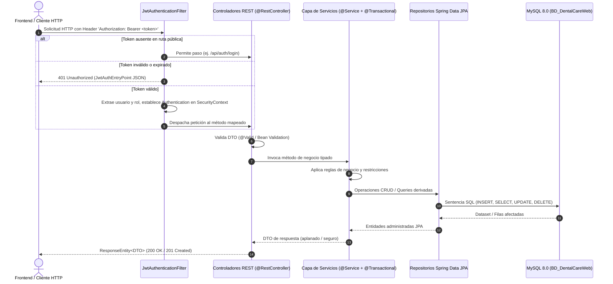
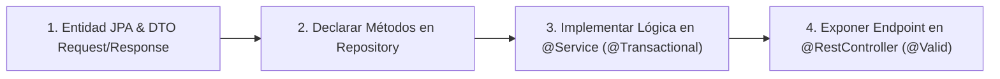

# GUÍA DE ARQUITECTURA E INTEGRACIÓN BACKEND: DENTALCARE API
> **Estándar:** Java 17, Spring Boot 3, Spring Security 6, Hibernate 6 / Spring Data JPA  
> **Directriz de Formato:** Especificación Arquitectónica Pura (sin volcados extensos de código fuente). Diseñado para que cualquier desarrollador o modelo de IA comprenda la arquitectura de dominio, reglas transaccionales, seguridad y contratos sin requerir inspección exhaustiva de archivos.

---

## 🏛️ 1. DICTAMEN Y PRINCIPIOS ARQUITECTÓNICOS

### 1.1 Decisiones Arquitectónicas Aprobadas
1. **Seguridad Stateless JWT Desacoplada:**
   - La API opera sin sesiones de servidor (`SessionCreationPolicy.STATELESS`), cumpliendo la especificación REST.
   - Autenticación delegada a tokens JWT firmados con clave simétrica HMAC-SHA256 (`${jwt.secret}`).
   - La autorización se basa en roles canónicos extraídos del reclamo (*claim*) `rol` del token e inyectados en `SecurityContextHolder`.
2. **Centralización Transversal de Excepciones (`@RestControllerAdvice`):**
   - Prohibido rodear métodos de controladores con bloques `try-catch` dispersos.
   - Todo error de validación (`MethodArgumentNotValidException`), violación de estado de negocio (`IllegalStateException`, `IllegalArgumentException`) o recurso no encontrado (`EntityNotFoundException`) se traduce a una respuesta estructurada con código HTTP semántico en la capa transversal.
3. **Integridad Relacional Preventiva:**
   - Antes de ejecutar operaciones destructivas (`DELETE`), el servicio debe comprobar la existencia de dependencias foráneas mediante consultas derivadas de repositorio (`existsBy...`) para evitar errores `500 Internal Server Error` causados por violaciones de clave foránea en MySQL.
4. **Configuración Externa (The Twelve-Factor App):**
   - Secretos criptográficos, tiempos de expiración y credenciales de base de datos se leen desde variables de entorno con fallbacks locales seguros en `application.properties`.

### 1.2 Antipatrones Descartados y Prohibidos
* **Prohibido:** Manejar estados de sesión HTTP en memoria del contenedor servlet.
* **Prohibido:** Inserción de valores de texto no sanitizados en motivos de cancelación o diagnósticos (requieren validación `@NotBlank` y `.trim()`).
* **Prohibido:** Persistir renglones de detalle farmacéutico (`DetallePrescripcion`) o de plan dental (`PlanTratamiento`) sin sus respectivas entidades maestras asociadas.

---

## 📦 2. HOJA DE RUTA DE COMMITS ATÓMICOS (JIRA)

| Commit | Tipo / Mensaje Semántico | Responsabilidad Arquitectónica | Componentes Afectados |
| :---: | :--- | :--- | :--- |
| **B1** | `feat(security)` | Infraestructura criptográfica JWT, filtro de intercepción y entry point 401 | `JwtUtil`, `JwtAuthenticationFilter`, `JwtAuthEntryPoint`, `application.properties` |
| **B2** | `feat(security)` | Cadena de filtros de seguridad, desactivación de CSRF y matriz de autorización | `SecurityConfig`, `PasswordEncoder` |
| **B3** | `fix(database)` | Compatibilidad de enumeraciones de cita y anulabilidad de diente en tratamientos generales | `EstadoCita`, `PlanTratamiento`, `DatabaseSchemaMigrationRunner` |
| **B4** | `fix(domain)` | Resolución de clave foránea de tratamiento y reutilización de prescripciones | `ConsultaService`, `ConsultaController` |
| **B5** | `feat(validation)` | Validación declarativa Bean Validation y verificación de integridad en borrado de pacientes | `CitaCancelacionDTO`, `CitaController`, `PacienteService`, `CitaRepository` |

---

## 🗂️ 3. TOPOLOGÍA DE CAPAS Y FLUJO DE EJECUCIÓN

---

## 🔒 4. MODELO DE SEGURIDAD Y CONTROL DE ACCESO (RBAC)

### 4.1 Ciclo de Vida del Token JWT
* **Algoritmo de Firma:** HMAC-SHA256 con clave secreta mínima de 256 bits.
* **Tiempo de Expiración:** 3,600,000 ms (1 hora) por defecto, configurable mediante `JWT_EXPIRATION_MS`.
* **Cuerpo de Reclamos (*Claims*):**
  - `sub`: Nombre de usuario único del sistema (`usernameUsuario`).
  - `rol`: Rol canónico en mayúsculas (`ADMIN`, `GERENTE`, `RECEPCIONISTA`, `ODONTOLOGO`).
  - `iat`: Timestamp de emisión.
  - `exp`: Timestamp de expiración.

### 4.2 Matriz de Autorización en `SecurityConfig`

| Patrón de URL | Métodos Permitidos | Nivel de Acceso Requerido | Propósito |
| :--- | :---: | :--- | :--- |
| `OPTIONS /**` | `OPTIONS` | Acceso Público | Negociación preflight CORS para navegadores web. |
| `/api/auth/**` | `POST` | Acceso Público | Login de usuarios y generación de token. |
| `/error` | Todos | Acceso Público | Despacho de errores internos de Spring. |
| `/api/usuarios/**` | Todos | `ADMIN`, `GERENTE` | Gestión de cuentas de usuario y credenciales. |
| `/api/registros-acceso/**`| Todos | `ADMIN` | Consulta de auditoría y registros de acceso. |
| `/api/consultas/**` | Todos | `ADMIN`, `ODONTOLOGO` | Protocolo clínico, evaluación, odontograma y recetas. |
| `/api/citas/**` | Todos | Autenticado | Gestión de agenda, programación y cancelaciones. |
| `/api/pacientes/**` | Todos | Autenticado | Expedientes clínicos y directorios. |
| **Cualquier otra ruta** | Todos | Autenticado | Denegación por defecto si no hay sesión válida. |

---

## 📐 5. ESPECIFICACIÓN DE ENTIDADES RELACIONALES Y REGLAS DE NEGOCIO

### 5.1 Entidad: `Cita` (Tabla `cita`)
* **Identificador:** `idCitas` (Integer, Auto-incremental).
* **Campos Clínicos:** `fechaCita` (`LocalDate`), `horaInicioCita` (`LocalDateTime`), `horaFinCita` (`LocalDateTime`).
* **Estado:** `estadoCita` (Enum `EstadoCita`). Valores válidos: `PROGRAMADA`, `PENDIENTE`, `EN_PROGRESO`, `COMPLETADA`, `CANCELADA`, `REPROGRAMADA`, `NO_ASISTIO`.
* **Regla de Cancelación:** Requiere `motivoCancelacion` no vacío.
* **Relaciones Foráneas:**
  - `paciente` (`id_paciente`): Obligatorio. Relación `ManyToOne`.
  - `odontologo` (`id_odontologo`): Obligatorio. Relación `ManyToOne` hacia la entidad `Usuario`.

### 5.2 Entidad: `EvaluacionClinica` (Tabla `evaluacion_clinica`)
* **Identificador:** `idEvaluacionClinica` (Integer, Auto-incremental).
* **Signos Vitales y Anamnesis:** `motivoConsulta`, `presionArterial`, `temperatura`, `pesoPaciente`, `observaciones`.
* **Relación:** Asociada de manera unívoca a la `Cita` activa (`ManyToOne` / `OneToOne` lógico).

### 5.3 Entidad: `PlanTratamiento` (Tabla `plan_tratamiento`)
* **Identificador:** `idPlanTratamiento` (Integer, Auto-incremental).
* **Pieza Dental (`piezaDental`):** `Integer`, **anulable (`nullable = true`)**. Tratamientos que no correspondan a un diente específico (ej. Profilaxis General) registran `NULL` o centinela `0`.
* **Relación con Tratamiento:** `tratamiento` (`id_tratamiento`) es **estrictamente obligatorio (`nullable = false`)**. Debe resolverse la entidad previa a la persistencia.
* **Estado:** `estadoPlan` (Enum `EstadoPlan`). Transiciones permitidas: `PENDIENTE` -> `PROGRAMADO` -> `EN_PROGRESO` -> `COMPLETADO` / `CANCELADO`.

### 5.4 Entidad: `Prescripcion` y `DetallePrescripcion`
* **Regla de Anexado:** Una consulta clínica posee una cabecera de prescripción por cita. Al emitir medicamentos adicionales en la misma sesión, el servicio no crea otra cabecera; reutiliza la existente y persiste los renglones adicionales en `DetallePrescripcion`.
* **Vínculo Opcional:** Cada renglón de detalle puede asociarse opcionalmente a un `PlanTratamiento` específico para relacionar el antibiótico o analgésico al procedimiento realizado.

---

## 🛠️ 6. PROTOCOLO DE EXTENSIÓN PARA MODELOS DE IA

Para modificar o agregar funcionalidades en el backend, siga este orden de intervención:

1. **Creación de Nuevo Endpoint:**
   - Crear DTOs de entrada y salida con anotaciones Jakarta Validation (`@NotNull`, `@NotBlank`, `@Positive`).
   - Crear el método transaccional en el `@Service` correspondiente. Si el recurso no existe, lanzar excepción semántica descriptiva.
   - Declarar el método en el `@RestController` retornando `ResponseEntity<DTO>`.
   - Si la ruta requiere un rol específico, asegurar que coincida con la configuración de `SecurityConfig` o usar `@PreAuthorize("hasRole('ADMIN')")`.
2. **Modificación de Esquema de Base de Datos:**
   - Modificar las anotaciones `@Column` en la entidad Java.
   - Generar la sentencia DDL correspondiente (`ALTER TABLE ...`).
   - Probar que no existan valores nulos conflictivos en columnas existentes.
   - Verificar la compilación del proyecto con `mvnw clean compile`.
